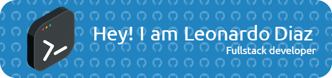

# ¡Hola! Soy Leonardo Diaz | LDiazDev 👋

### 💻 Fullstack Developer & QA Enthusiast
Me apasiona transformar ideas complejas en soluciones digitales robustas. Mi enfoque combina la arquitectura backend (Java/Spring) con experiencias de usuario dinámicas (Angular/React), siempre bajo la lupa de la calidad y las mejores prácticas.

---

## 🤝 Conectemos

---

## 🛠️ Stack Tecnológico

### **Backend & Databases**

### **Frontend & UI/UX**

### **Herramientas & Deployment**

---

## 📊 Mi Actividad en GitHub

  
  

---

## ⚡ Sobre mí
- 🔭 **Actualmente trabajando en:** Un sistema POS multinegocio escalable.
- 🌱 **Aprendiendo continuamente:** Profundizando en Microservicios y Testing automatizado.
- 💬 **Hablemos de:** Desarrollo web, arquitectura de bases de datos o por qué el código limpio ahorra dinero a las empresas.
- 🎸 **Dato curioso:** Fuera de la pantalla, estoy practicando mis acordes en la guitarra acústica.
